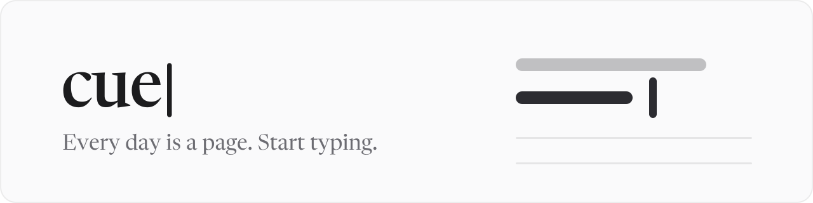
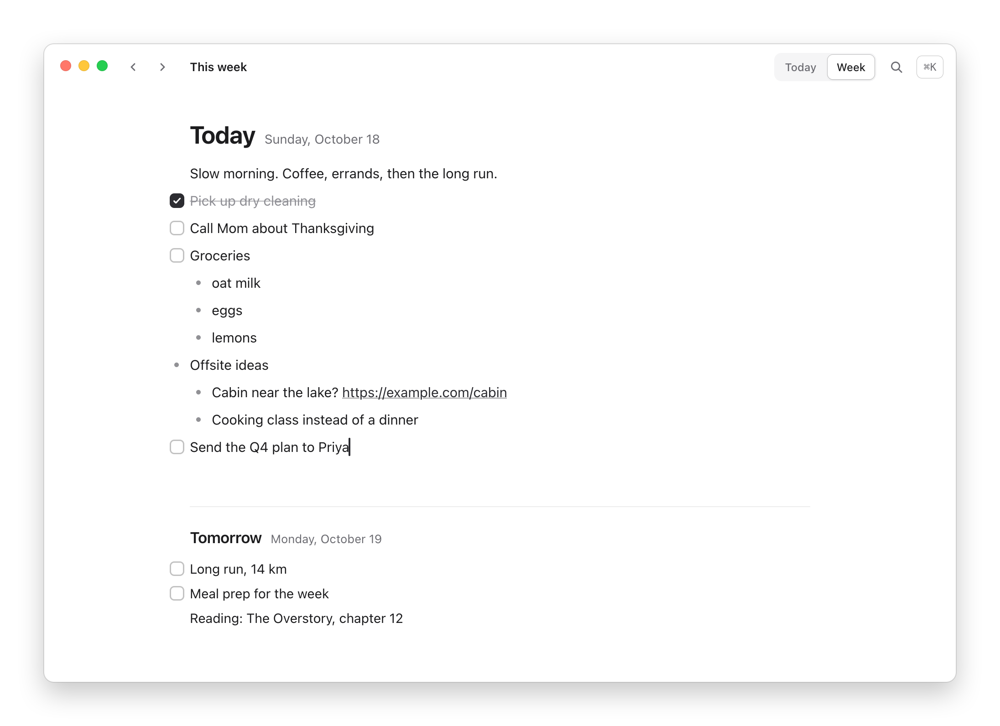
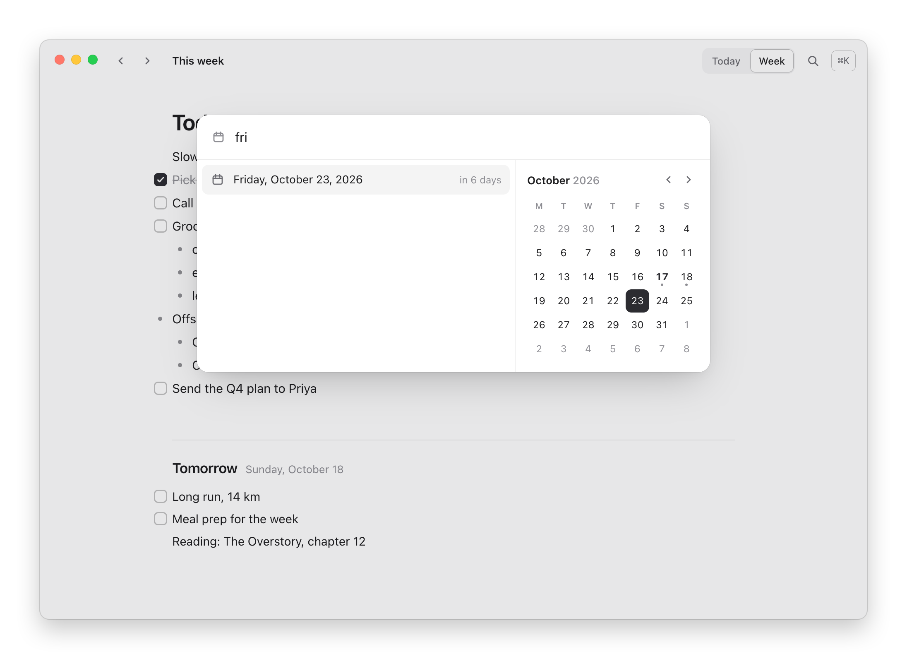
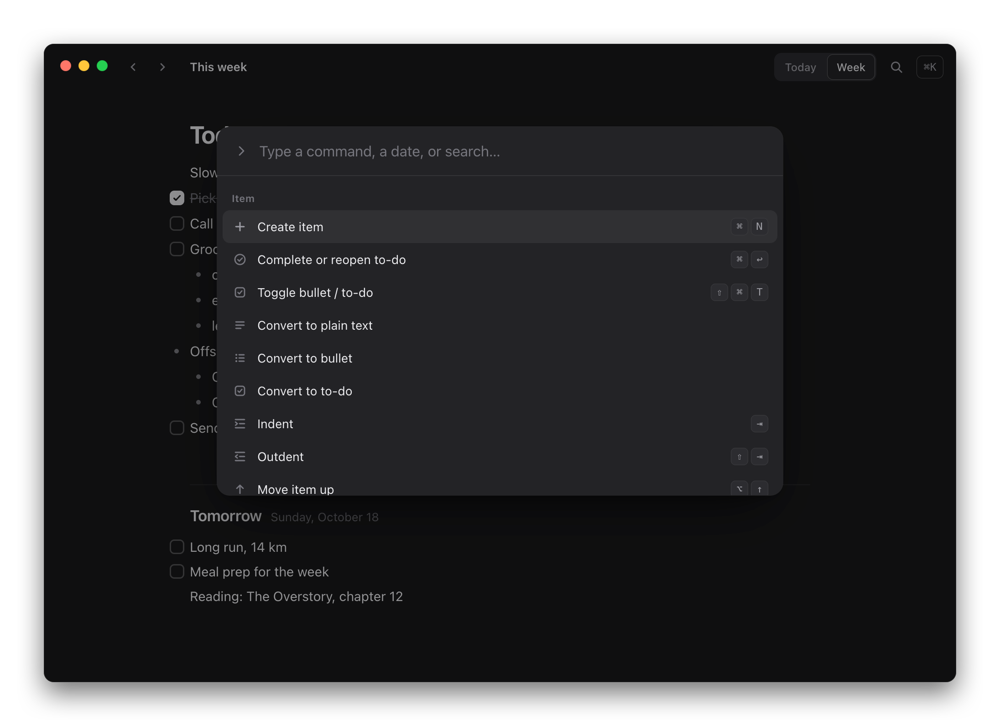
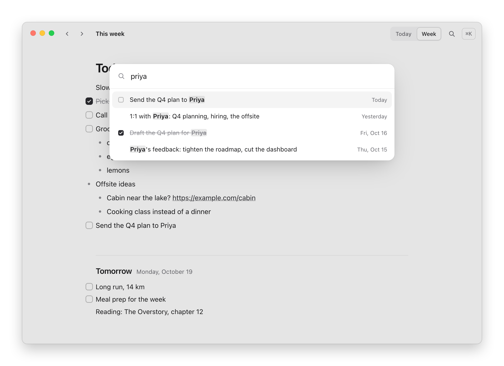
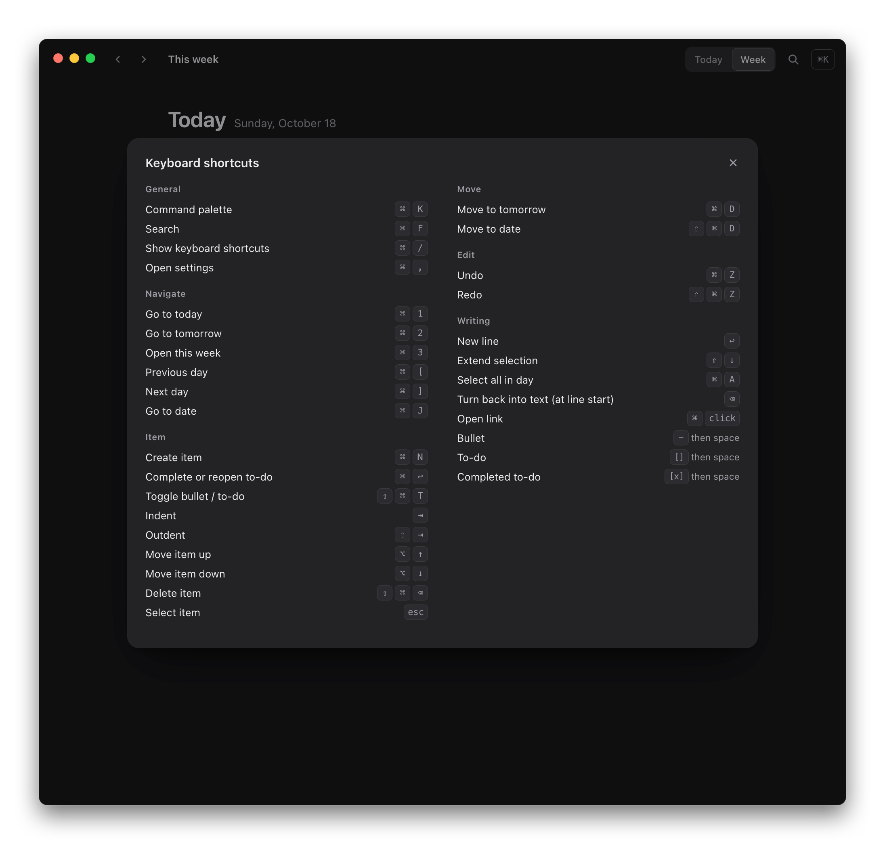

<picture>
  <source media="(prefers-color-scheme: dark)" srcset="docs/brand/readme/readme-header-dark.svg">
  
</picture>

<p align="center">
  <strong>Daily notes and to-dos for Mac and iOS.</strong><br>
  Fast, quiet and keyboard-first.
</p>

> [!NOTE]
> **Cue is in beta.** I use it every day on my Mac and iPhone as my daily driver, without
> any issues. It's still young, so export now and then (File ▸ Export as Markdown).

<picture>
  <source media="(prefers-color-scheme: dark)" srcset="docs/images/week-dark.png">
  
</picture>

Every day in Cue is a page of text, bullets and to-dos. Open the app and start typing into
today. There are no projects, tags or priorities: just days, and what you wrote on them.

- **The day is the only folder.** Things belong to dates. What didn't get done moves to
  tomorrow with ⌘D.
- **Keyboard first, mouse friendly.** Every action has a shortcut and lives in ⌘K.
- **Fast and safe, or it isn't done.** Nothing waits on a save, and speed is measured
  against budgets (see [Performance](#performance)).

## Features

**Writing.** Text, bullets and to-dos, nested as deep as you like. Markdown shortcuts as you
type (`- `, `[] `, `[x] `), and pasted Markdown lists become real nested items.

**Organizing.** A week view with today on top, a day view for any date, and ⌘[ / ⌘] to step
between them. Reorder with ⌥↑/⌥↓ or drag and drop, even onto another day. Move anything to
tomorrow (⌘D) or any date (⇧⌘D), and select several lines to act on them together.

<p align="center">
  
</p>

**Finding.** ⌘K searches every command and understands dates ("move to fri", "go to oct 31").
⌘F searches every day you've written, ignoring case and accents.

<p align="center">
  
  
</p>

**Reliability.** Saves as you type, with undo and redo for everything. Edits survive a crash
(the tests `kill -9` the app to check), a daily snapshot is kept for 14 days, and both apps
export to Markdown or JSON at any time.

**Sync.** Optional on the Mac and iPhone, and off by default. Sign in with Apple, or with your email and
a six-digit code, and edits reach your other devices about a second after you stop typing. It works
offline and never interrupts typing.

**Assistants.** With sync on, connect Claude, ChatGPT or another assistant over MCP to read
your days, add to-dos, check them off and move them, from wherever you're chatting. Nothing it
can call deletes anything. See [usecue.today/assistants](https://www.usecue.today/assistants)
and [docs/MCP.md](docs/MCP.md).

**iPhone.** The same core as the Mac, built for touch: tap a bullet to make it a to-do, tap a
box to check it, swipe to complete or send to tomorrow, and long-press to drag. Like the
Mac, it needs no account; turn on sync to share notes with your Mac. Share a link from any app to add it to today, and a line
that's only a link shows its page. See [mobile/README.md](mobile/README.md).

**Feel.** One calm column in monochrome graphite, system typography, and light and dark
appearance. The caret is the brand: it holds still while you type and rests after ten idle
seconds.

## Keyboard

| Action | Shortcut |
| --- | --- |
| Command palette | ⌘K |
| Search | ⌘F |
| Today · Tomorrow · This week | ⌘1 · ⌘2 · ⌘3 |
| Previous / next day | ⌘[ · ⌘] |
| Go to date | ⌘J |
| New item | ⌘N, or just start typing |
| Complete / reopen | ⌘↩ |
| Toggle bullet ↔ to-do | ⇧⌘↩ |
| Indent / outdent | Tab · ⇧Tab |
| Move up / down | ⌥↑ · ⌥↓ |
| Move to tomorrow | ⌘D |
| Move to date | ⇧⌘D |
| Delete item | ⇧⌘⌫ |
| Select lines | Esc, then ⇧↑ / ⇧↓ (⌘A twice for the whole day) |
| Undo / redo | ⌘Z · ⇧⌘Z |
| Every shortcut | ⌘/ |

<p align="center">
  
</p>

## Performance

Every number comes from `pnpm bench`, which drives the real packaged Mac app, and each has a
budget it must stay under.

| Measure | Result | Budget |
| --- | --- | --- |
| Launch → ready to type (5 years of notes) | 240 ms | ≤ 400 ms |
| Keystroke → frame rendered | 1.5 ms · p95 3.7 ms | ≤ 12 ms |
| Enter → new line rendered | 2.0 ms · p95 5.4 ms | ≤ 16 ms |
| ⌘↩ → to-do toggled | 7.6 ms · p95 11 ms | ≤ 16 ms |
| ⌘[ → previous day rendered | 10 ms · p95 13 ms | ≤ 50 ms |
| Search 36,543 items | 0.5 ms · p95 6.6 ms | ≤ 50 ms |
| Memory, idle after launch | 108 MB | |
| Download (.dmg) | 122 MB | |

<sub>Apple M4 Pro, macOS 26.6, packaged arm64 build on a 120 Hz display. Budgets apply to the
p95. `pnpm bench` prints the full table, including indent, reorder, storage and bundle size.</sub>

It's fast because a keystroke re-renders exactly one line, writes happen in the background
within 40 ms, and only the days on screen are loaded. Cue runs on Electron because Chromium's
text editing is the most reliable base for an editor like this. The cost is a bigger download
and more memory than a native app, and the budgets keep the rest honest.

```sh
pnpm package
pnpm bench            # prints the table
pnpm bench --check    # exits non-zero if anything misses its budget
```

## Getting started

Download Cue from [usecue.today/download](https://www.usecue.today/download): the Mac app for
Apple silicon, signed and notarized, and the iPhone beta on TestFlight. Both are free and work
offline with no account. Syncing them together needs an account (Sign in with Apple, or an
emailed code), and that’s free as well.

### Build it yourself

Build Cue from source on an Apple silicon Mac with Node 24+ and pnpm:

```sh
git clone https://github.com/zlwaterfield/cue.git
cd cue
pnpm install
pnpm dev        # run with hot reload
pnpm package    # or build release/mac-arm64/Cue.app
```

Development builds run as "Cue Dev" and keep their data separate from the packaged app, so
working on Cue can't touch your notes.

For the iPhone app, see [mobile/README.md](mobile/README.md). It needs Xcode 26 and a sync
server: your own Supabase project, set up as in [docs/SYNC.md](docs/SYNC.md).

## Your data

- On the Mac, everything lives in one SQLite file at
  `~/Library/Application Support/Cue/cue.sqlite`, with daily snapshots in `Backups/`.
- No telemetry, analytics or tracking. Without sync, Cue never talks to a server.
- With sync on, your notes are also stored on the sync server (Cue's, or your own if you
  build it yourself). Turning sync off keeps every note on your Mac, and you can delete the
  account from Settings.
- File ▸ Export as Markdown writes one file per day; Export JSON Backup writes everything.
  On the iPhone, Settings → Your notes shares the same two: the Markdown as a zip, the
  backup as the file the Mac imports.
- The hosted service's [Privacy Policy](https://www.usecue.today/privacy) and
  [Terms](https://www.usecue.today/terms) are short and in plain words.

## How it's built

- **Mac:** Electron, React 19 and TypeScript. Storage is SQLite through Node's built-in
  `node:sqlite`, owned by the main process.
- **iPhone:** Expo and React Native.
- **Shared core:** both apps share `src/shared`: the data model, storage, sync engine and
  every editing operation.
- **Sync:** an optional Supabase backend (Postgres, Auth, Realtime), newest edit wins per
  item.

More in [docs/ARCHITECTURE.md](docs/ARCHITECTURE.md), [docs/SYNC.md](docs/SYNC.md),
[docs/MCP.md](docs/MCP.md) and [docs/ACCEPTANCE.md](docs/ACCEPTANCE.md). The brand kit lives
in [docs/brand](docs/brand).

## Roadmap

There isn't a big one, on purpose. Cue is meant to stay small, so most of the work goes into
making what's already here faster and more dependable. Nothing below is promised to a date.

**Before the stable 1.0:** a stable storage format with tested migrations, and automatic
updates on the Mac.

**Not planned:** projects, tags, priorities, reminders, recurring tasks, attachments,
collaboration, AI built into the app and dashboards.

## Contributing

Issues and pull requests are welcome. For anything bigger than a fix, open an issue first.

```sh
pnpm test         # unit tests
pnpm test:e2e     # end-to-end tests against the real app
pnpm test:sync    # sync and MCP against a local Supabase (see docs/SYNC.md)
pnpm typecheck
pnpm bench        # performance against the budgets
```

A few rules keep Cue the way it is:

- **Every action is a command** in `src/shared/commands.ts`, so it gets a shortcut, a palette
  entry and a menu item together.
- **Performance is a requirement.** If a change touches typing, navigation, search or
  startup, run `pnpm bench`.
- **Data safety comes first.** Reads and writes go through the repository, migrations only
  append, and anything that could lose data needs a test.
- **Less, but better.** Make the daily page better without adding fields, panels or settings.

## License

The code is [MIT](LICENSE) © 2026 Zach Waterfield.

The Cue name, logo and app icon ([docs/brand](docs/brand)) aren't covered by the MIT license.
You're welcome to use them to refer to Cue, but not for your own app or in a way that suggests
endorsement. If you distribute a modified version, give it a different name and icon.
