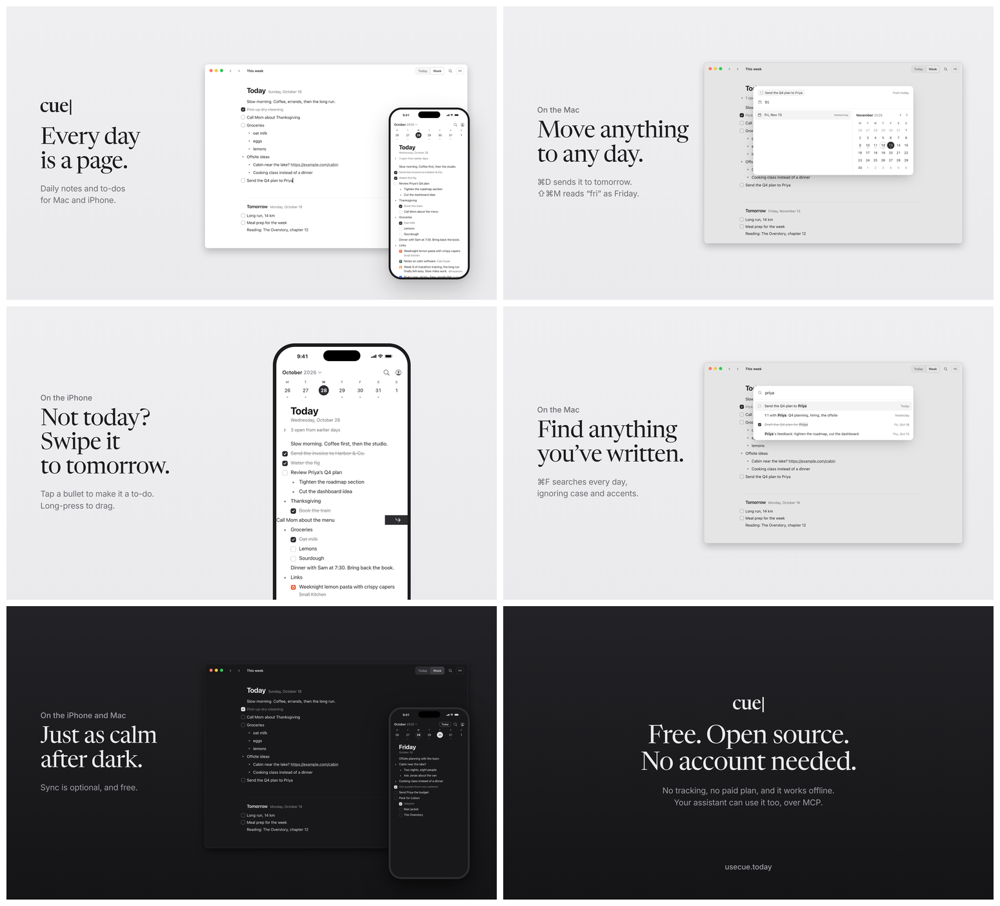

# Product Hunt gallery

The gallery for Cue's launch on Product Hunt, in the order to attach them. Each one is
2540 × 1520, Product Hunt's recommended 1270 × 760 at 2x, and a PNG.

| # | Image | Headline | Screen |
| --- | --- | --- | --- |
| 1 | [01-every-day](01-every-day.png) | Every day is a page. | The Mac's week, with the iPhone's day in front |
| 2 | [02-mac-move](02-mac-move.png) | Move anything to any day. | Move to on the Mac, ⇧⌘M, reading "fri" |
| 3 | [03-iphone-swipe](03-iphone-swipe.png) | Not today? Swipe it to tomorrow. | A to-do swiped on the iPhone |
| 4 | [04-search](04-search.png) | Find anything you've written. | ⌘F on the Mac, for "priya" |
| 5 | [05-dark](05-dark.png) | Just as calm after dark. | The Mac and the iPhone in dark |
| 6 | [06-free](06-free.png) | Free. Open source. No account needed. | The lockup on Night |

The thumbnail is the app icon, `brand/app-icon/macos/cue-icon-light-1024.png`: it is
opaque, so it holds on Product Hunt's light and dark themes, and it is the icon people
will see in the Dock.

## Why one shape

Product Hunt shows every gallery image in the same landscape frame. Images of different
shapes are cropped or letterboxed differently from one to the next, so the gallery jumps
as it plays. These are all one shape, laid out for that frame. The first is the one
Product Hunt shows largest, so it carries the brand line; the last ends on Night, like
the launch video.

## Rebuilding

    pnpm ph-gallery

`apps/desktop/scripts/ph-gallery.mjs` lays each image out in HTML at 1270 × 760 CSS
pixels and takes it in Chrome at 2x, the same way `pnpm x-carousel` makes the images
for X. The Mac windows are the README screenshots in `docs/images`, and the iPhones are
the plain App Store screens in `brand/app-store/screens`, in the same frame
`brand/app-store/creative/make.py` draws. The headlines are set in Newsreader on the
brand's graphite palette. Pass part of a file name to render only that image, such as
`pnpm ph-gallery 03`. `overview.png` is the six at a glance, scaled down.
