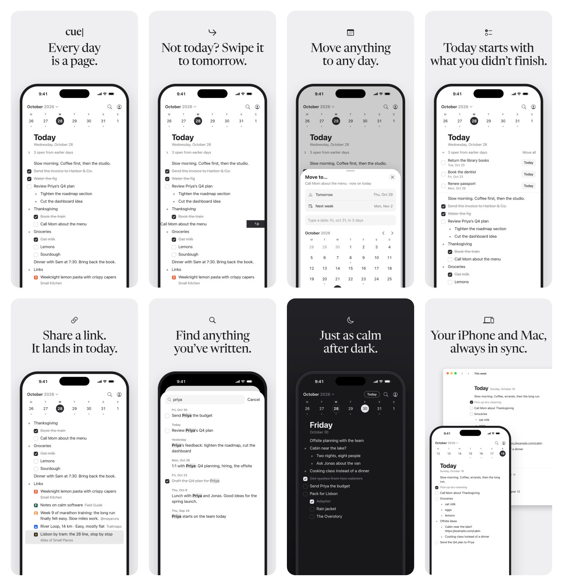
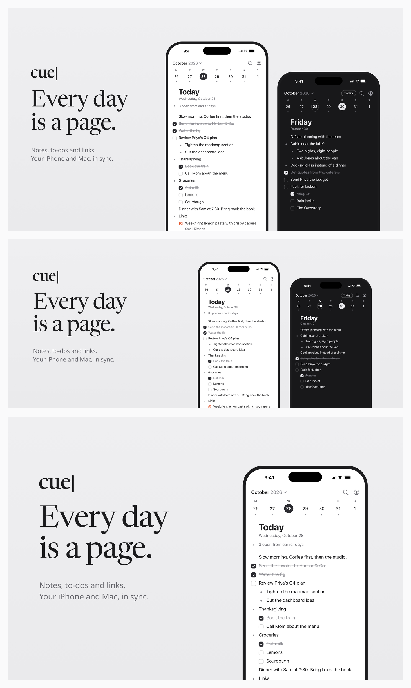

# App Store images

The iPhone app's App Store images. App Store Connect takes two kinds, in two
different places: portrait **screenshots** (below) and landscape **creative assets**
([`creative/`](creative/)). Every slot takes only its own fixed sizes and rejects
anything else, so a screenshot can't go in a creative asset slot, or the other way
round, and even the two screenshot slots don't share a size.

## Screenshots

Portrait, in upload order, at both of the iPhone sizes App Store Connect asks for.

| # | Image | Headline | Screen |
| --- | --- | --- | --- |
| 1 | [01-today](store/01-today.png) | Every day is a page. | Today, with to-dos, nested bullets and a list |
| 2 | [02-swipe](store/02-swipe.png) | Not today? Swipe it to tomorrow. | A to-do swiped left, past where tomorrow arms |
| 3 | [03-move](store/03-move.png) | Move anything to any day. | The Move to… sheet |
| 4 | [04-earlier](store/04-earlier.png) | Today starts with what you didn't finish. | The earlier to-dos, unfolded |
| 5 | [05-links](store/05-links.png) | Share a link. It lands in today. | Link previews, the newest one just shared |
| 6 | [06-search](store/06-search.png) | Find anything you've written. | Search for "priya" |
| 7 | [07-dark](store/07-dark.png) | Just as calm after dark. | Friday, in dark |
| 8 | [08-mac](store/08-mac.png) | Your iPhone and Mac, always in sync. | The same day on the phone and in the Mac's README screenshot |

`screens/` holds the plain screenshots, and `store/` and `store-6.3/` the images to
upload — the same eight at two sizes, all PNGs without alpha. `screens/08-mac.png` has a
second job: it is also the iPhone on the website's home page, and `screens/01-today.png`
and `screens/07-dark.png` are what the dark version of it is derived from
(`apps/desktop/scripts/phone-shots.py`), so changing those three changes the site too.

- **`store-6.3/`, 1206 × 2622.** The slot for 6.1" and 6.3" displays, which is the one
  Apple requires of an iPhone app. It takes 1179 × 2556 or 1206 × 2622 and nothing else,
  so a 1320 × 2868 image is rejected there with "Supported sizes include 2556 × 1179px,
  1179 × 2556px, 2622 × 1206px and 1206 × 2622px." Rebuild with
  `python3 docs/app-store/store-6.3/make.py` (Pillow), which scales `store/` down — the
  two sizes are the same shape to within 0.07%, under a pixel over the height.
- **`store/`, 1320 × 2868.** The 6.9" slot, which is optional. These were laid out at
  this size, so they are the ones to edit; `store-6.3/` follows from them.
- The sizes are from
  [Screenshot specifications](https://developer.apple.com/help/app-store-connect/reference/app-information/screenshot-specifications/).
  Apple moves which slot it requires, so read that page before dropping a size.
- App previews are optional and there are none. They are video, 886 × 1920 at 6.3".
- The app's `supportsTablet` is on, so App Store Connect also asks for 13" iPad screenshots.
  There are none yet.

## Creative assets

Landscape, for the product page header and for search results. These are a separate
section in App Store Connect from the screenshots, and the only sizes it takes are the
ones below — a 1320 × 2868 screenshot is rejected there with "Supported sizes include
5244 × 2950px, 3840 × 2560px and 1920 × 1280px."

| Image | Size | Ratio | Placement |
| --- | --- | --- | --- |
| [universal-16x9](creative/universal-16x9-5244x2950.png) | 5244 × 2950 | 16:9 | Both. The one size each slot shares, so upload this if you only upload one. PNG only. |
| [header-21x9](creative/header-21x9-3840x1646.png) | 3840 × 1646 | 21:9 | Product page header |
| [search-3x2](creative/search-3x2-3840x2560.png) | 3840 × 2560 | 3:2 | Search results, at the largest size that slot takes (its smallest is 1920 × 1280). |

All three are PNGs without alpha, which App Store Connect requires. The sizes are from
[Creative asset specifications](https://developer.apple.com/help/app-store-connect/reference/app-information/creative-assets-specifications/);
check that page before changing them, since Apple moves them.

Rebuild them with `python3 docs/app-store/creative/make.py` (Pillow, Playwright and a
Chrome or Chromium). It lays the same screens out in landscape with the headline and the
graphite palette the screenshots use, and flattens the alpha channel.

## How the screens were made

The screens are the iPhone app's own React Native screens, run through Expo's web target
in Chrome at the iPhone 17 Pro Max's size (440 × 956 pt at 3×). They use SF Pro with iOS's
tracking, SF Symbols drawn from SF Pro's outlines, and the iPhone's safe area. An
example account was written into the app's database, and link previews came from the
app's own parser. The iOS status bar, the sheet chrome and the held swipe were added
around them.

The headlines are set in Newsreader, the brand's display face, on the brand's graphite
palette. The example sites, their icons and the post on X are made up.
